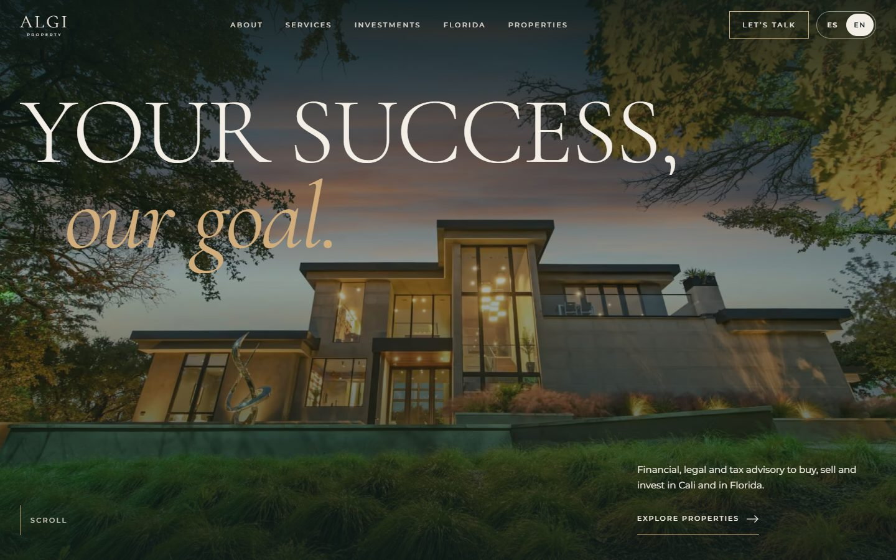
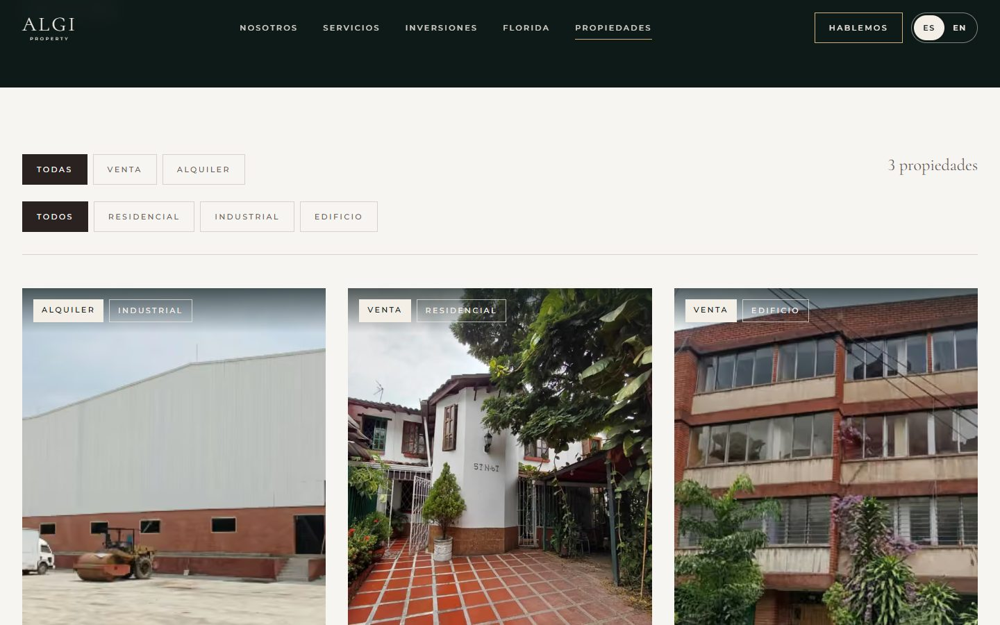
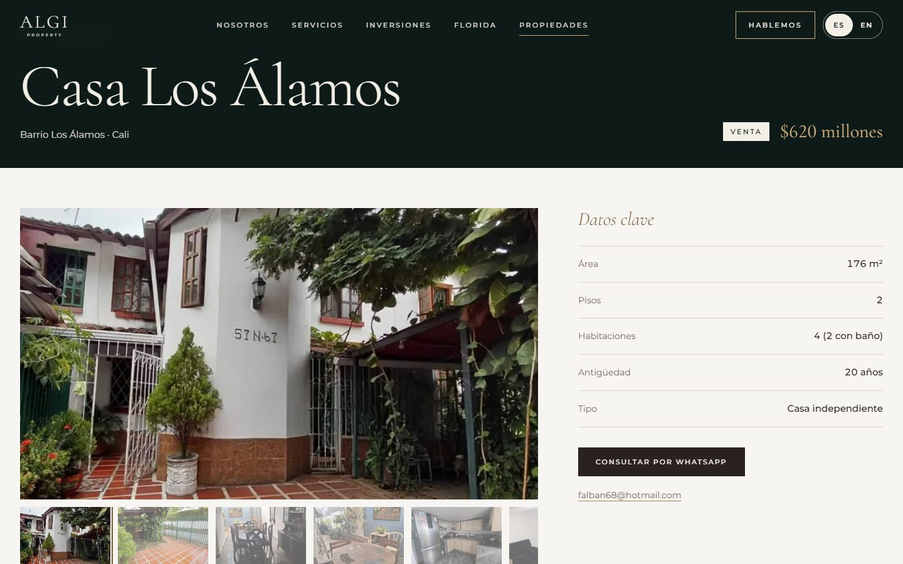
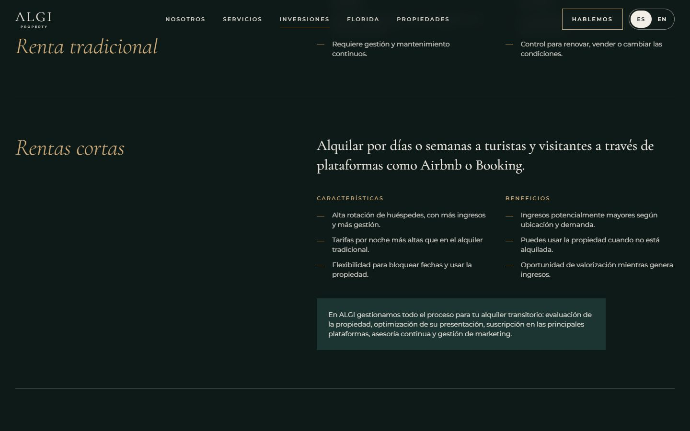

# ALGI Property

Sitio web bilingüe (español e inglés) para **ALGI Property**, una consultoría inmobiliaria de Cali, Colombia, con servicios de asesoría financiera, legal y tributaria, compra y venta, inversión y un puente de inversión hacia la Florida, EE. UU.

**Sitio en vivo: [www.algiproperty.com](https://www.algiproperty.com)**

Es un proyecto de portafolio personal. La empresa tuvo un sitio web anterior que ya no existe, y este es un rediseño hecho con el contenido, el logo y los inmuebles que ALGI Property proporcionó para este fin.


## Qué incluye

- **Portada cinematográfica** a pantalla completa, con zoom lento de la foto, parallax al desplazar y titulares que suben desde una máscara.
- **Español e inglés** con un botón ES / EN arriba a la derecha. Un clic cambia el idioma y conserva la página en la que estás. Si entras por `/`, el sitio detecta el idioma del navegador.
- **7 secciones**: Inicio, Nosotros, Servicios, Inversiones, Florida, Propiedades y Contacto.
- **Catálogo de 37 propiedades** (Cali, Cartagena, Lago Calima, Dapa, Yumbo, Jamundí, Palmira y Bogotá) con filtros por operación (venta, alquiler o propiedades de inversión con renta) y categoría (residencial o comercial). Al elegir una categoría se despliega un tercer filtro por tipo: casas, apartamentos, aparta estudios y fincas, o lotes, locales, bodegas, edificios, oficinas y hoteles. Las tarjetas se reordenan con animación y los filtros viven en la URL (`?operacion=inversion&categoria=comercial&tipo=local`), así se pueden compartir.
- **Ficha por inmueble** con galería, vista ampliada accesible (teclado, Escape), datos clave y botón de WhatsApp con un mensaje ya redactado para esa propiedad.
- **Ficha técnica en PDF** para descargar desde cada inmueble, en español e inglés: dos páginas A4 con el logo, la foto principal, el precio, los datos clave, las características, una galería y un código QR que lleva a la ficha en línea.
- **Registro de interesados**: antes de descargar la ficha, la persona deja sus datos y autoriza el contacto. Se guardan en una base de datos y ALGI recibe un aviso por correo con un botón para responder por WhatsApp.
- **Política de tratamiento de datos** en español e inglés (Ley 1581 de 2012), enlazada desde el formulario y el pie de página.
- **Formulario de contacto** que valida los campos y abre WhatsApp o el correo con el mensaje listo. No tiene servidor ni guarda datos.
- **SEO**: etiquetas `hreflang`, canónicas, Open Graph, `sitemap.xml`, `robots.txt` y datos estructurados de `RealEstateAgent`.
- **Accesibilidad**: enlace para saltar al contenido, foco visible, navegación completa por teclado, contrastes WCAG AA y respeto de "reducir movimiento".

| Inglés | Inglés |
|---|---|
|  |  |

| Catálogo | Ficha de inmueble |
|---|---|
|  |  |

| Inversiones | Móvil |
|---|---|
|  |  |

## Stack

| Área | Herramientas |
|---|---|
| Framework | Next.js 16 (App Router, Cache Components), React 19, TypeScript |
| Estilos | Tailwind CSS 4 con tokens de diseño propios |
| Idiomas | next-intl (rutas `/es` y `/en`) |
| Movimiento | Motion, Lenis (scroll suave) y animaciones CSS ligadas al scroll |
| PDF | React-PDF, sharp (recorte de fotos) y qrcode |
| Interesados | Neon (Postgres serverless) y Resend (correo), con rutas de API de Next.js |
| Pruebas | Playwright y axe-core |
| Tipografía | Cormorant Garamond y Montserrat, alojadas en el propio sitio con `next/font` |

Los datos de los inmuebles están en archivos locales (`src/data/`) y el contenido de las páginas en `src/content/`, en ambos idiomas. Los interesados que descargan fichas se guardan en Postgres (Neon); ver [Registro de interesados](#registro-de-interesados).

## Cómo correrlo

Requisitos: Node.js 22.18 o superior.

```bash
npm install
npm run dev          # http://localhost:3000
```

Para probar el build de producción:

```bash
npm run build
npm run start
```

Variable opcional (ver `.env.example`): `NEXT_PUBLIC_SITE_URL`, la URL pública del sitio, usada para canónicas, sitemap y Open Graph.

## Registro de interesados

Antes de descargar una ficha técnica, la persona deja nombre y teléfono (correo opcional) y autoriza el tratamiento de sus datos. Con eso:

1. `/api/interesados` valida los datos y frena robots: campo trampa, tiempo mínimo de llenado, solo JSON desde el propio sitio y un máximo de envíos por IP (guardada como huella cifrada que se borra al día).
2. Guarda el registro en **Neon** (Postgres): datos, inmueble, idioma, fecha y versión de la política aceptada.
3. Envía un aviso por **Resend** al correo de ALGI, con un botón de WhatsApp que abre un mensaje ya redactado para esa persona, en su idioma.
4. Responde con un enlace firmado que vence a los 15 minutos. `/api/ficha` solo entrega el PDF con ese enlace: las fichas viven en `fichas-privadas/`, fuera de `public/`.

Si la base de datos o el correo fallan, basta con que uno de los dos funcione para no perder el contacto.

### Configuración

Variables en Vercel (Settings > Environment Variables) y en `.env.local` para desarrollo; ver `.env.example`:

| Variable | Qué es |
|---|---|
| `FICHAS_SECRETO` | Secreto aleatorio de 32+ caracteres para firmar los enlaces |
| `DATABASE_URL` | Cadena de conexión de Neon |
| `RESEND_API_KEY` | Clave de API de Resend |
| `AVISOS_REMITENTE` | Remitente de un dominio verificado en Resend, por ejemplo `ALGI Property <avisos@algiproperty.com>` |
| `AVISOS_DESTINO` | Correo(s) que reciben los avisos, separados por coma |

Las tablas se crean con `npm run db:esquema` (lee `DATABASE_URL` de `.env.local`) o pegando `db/esquema.sql` en el editor SQL de Neon. Sin estas variables, el formulario responde con un error y ofrece WhatsApp; en desarrollo y pruebas se usa `LEADS_MODO=prueba`, que firma enlaces sin guardar ni enviar nada.

### Consultas útiles (editor SQL de Neon)

```sql
-- Últimos interesados
SELECT creado AT TIME ZONE 'America/Bogota' AS fecha, nombre, telefono, correo, propiedad
FROM interesados ORDER BY creado DESC LIMIT 50;

-- Inmuebles con más interés
SELECT propiedad, count(*) AS interesados FROM interesados GROUP BY propiedad ORDER BY 2 DESC;

-- Avisos que no se pudieron enviar
SELECT * FROM interesados WHERE NOT aviso_enviado ORDER BY creado DESC;

-- Borrar los datos de una persona que lo pida (derecho de supresión)
DELETE FROM interesados WHERE telefono = '+573001234567';
```

## Pruebas

La suite de extremo a extremo corre sobre el build de producción y usa el Chrome instalado en el equipo.

```bash
npm run build
npm run test:e2e
```

Son 302 pruebas:

- Cada una de las 45 páginas en ambos idiomas responde 200, tiene un solo `h1`, no se desborda en 390 px y no tiene violaciones serias de accesibilidad (axe, WCAG 2.2 AA).
- Cambio de idioma, detección del idioma del navegador, filtros del catálogo (operación, categoría y tipo comercial), galería, formulario (validación y mensaje de WhatsApp) y menú móvil.
- Registro de interesados: la ventana de descarga (validación, autorización sin marcar, descarga y datos recordados), las 70 fichas entregadas tras el formulario, enlaces alterados o vencidos rechazados, y los filtros contra robots.
- 404 reales, sitemap y cabeceras de seguridad.

También hay `npm run lint` y `npm run typecheck`.

## Calidad

Lighthouse sobre el build de producción, en móvil con red y CPU limitadas por simulación:

| Rendimiento | Accesibilidad | Buenas prácticas | SEO |
|---|---|---|---|
| 85 a 98 | 100 | 100 | 100 |

En escritorio el rendimiento fue de 98 a 100. `npm audit` no reporta vulnerabilidades.

## Decisiones técnicas

- **Cabeceras de seguridad** en `next.config.ts`: CSP, `X-Frame-Options`, `Referrer-Policy`, `Permissions-Policy` y HSTS. La CSP permite scripts en línea porque Next.js los necesita para hidratar las páginas prerenderizadas; no se carga ningún recurso de terceros.
- **404 reales**: con Cache Components, una ficha inexistente se transmitiría con estado 200. El `proxy` la reescribe hacia una ruta desconocida para que responda 404 con el diseño del sitio.
- **Entrada al hacer scroll solo con CSS** (`animation-timeline: view()`): el contenido está en el HTML inicial y no depende de la hidratación de React, lo que mejoró el LCP.
- **Formulario sin servidor**: arma el mensaje en el navegador y lo abre en WhatsApp o en el cliente de correo. Un siguiente paso natural sería enviarlo con un servicio como Resend.
- **Fichas PDF generadas en el build**: `scripts/fichas-pdf.mjs` se ejecuta antes de cada `npm run build` y crea un PDF por inmueble e idioma en `fichas-privadas/`, una carpeta fuera de `public/` que se incluye en la función de descarga (`outputFileTracingIncludes`). Las propiedades nuevas tienen su ficha sin pasos manuales. Las fotos se eligen por resolución: cada una debe verse nítida en el espacio que ocupa; las de baja calidad o ilustrativas se descartan, y una foto concreta se puede excluir con `ficha: false`. Si el texto es largo, la galería pasa de 6 fotos a 3 para que la ficha quepa siempre en dos páginas.
- **Fotos optimizadas**: las fichas originales pesaban 41 MB en PDF. `scripts/optimizar-fotos.py` extrae y convierte las fotos a WebP (1,9 MB en total).

## Estructura

```
messages/          textos de la interfaz (es.json, en.json)
public/images/     fotos de inmuebles y de ambientación
db/                esquema de la base de datos de interesados
scripts/           optimización de fotos, fichas PDF y creación de tablas
src/app/           rutas, layout, sitemap, robots y rutas de API (interesados, ficha)
src/components/    componentes de interfaz
src/content/       contenido de las páginas en ambos idiomas
src/data/          inmuebles, contacto y créditos de fotos
src/i18n/          configuración de idiomas y navegación
tests/e2e/         pruebas de Playwright
DESIGN.md          sistema de diseño: color, tipografía, movimiento
```

## Contenido y créditos

- **Marca, textos e inmuebles**: pertenecen a ALGI Property y se usan con su autorización como proyecto de portafolio. Las imágenes del edificio remodelado en la ficha del Edificio Granada son ilustrativas y están rotuladas como tal.
- **Fotos de ambientación** (licencia de Unsplash): portada, [Michael Brown](https://unsplash.com/@vettexan); Miami, [Pratham Verma](https://unsplash.com/@vpratham04) y [Jairo Gonzalez](https://unsplash.com/@jair0g0nza); Cali, [JUAN MANUEL GONZALEZ RESTREPO](https://unsplash.com/photos/HjUAiKw1m-E) y [Andres F. Uran](https://unsplash.com/@andresuran).
- **Cifras de financiamiento y requisitos** de las páginas Servicios y Florida provienen del contenido original y son informativas, no asesoría financiera.

## In English

Bilingual (Spanish / English) website for ALGI Property, a real estate consultancy in Cali, Colombia. Built with Next.js 16, TypeScript, Tailwind CSS 4 and next-intl, it features a cinematic full-screen hero, a filterable catalogue of 20 properties (residential and commercial), property detail pages with an accessible gallery, a WhatsApp/email contact form and full SEO. It scores 100 for accessibility, best practices and SEO on Lighthouse, and ships with 183 end-to-end tests (Playwright and axe). It is a personal portfolio project built with content supplied by the company.

## Autor

Juan José Alban · [@alban0918](https://github.com/alban0918)
