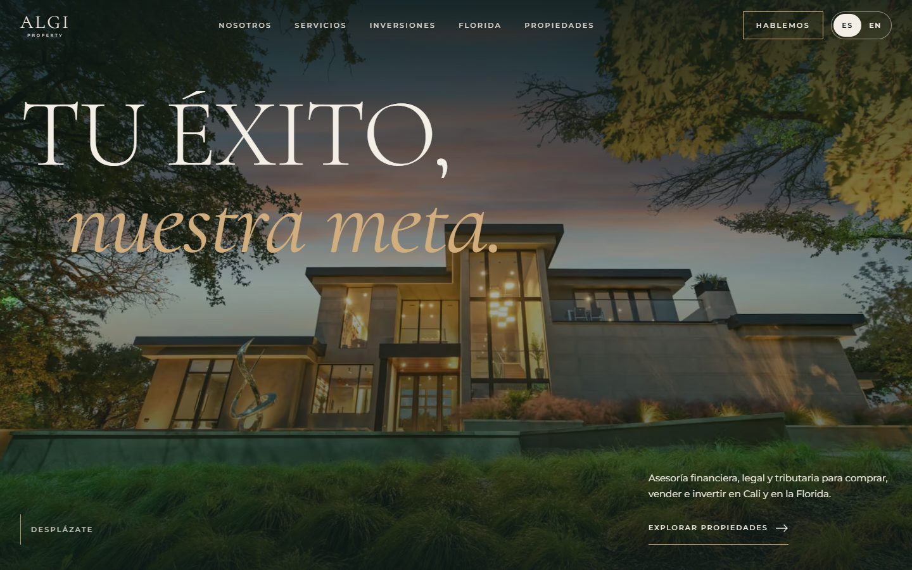
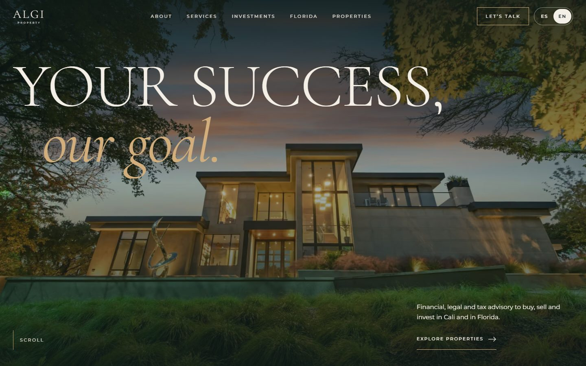
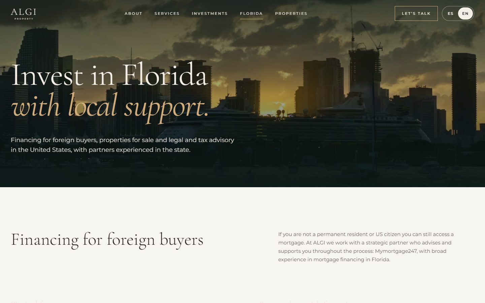
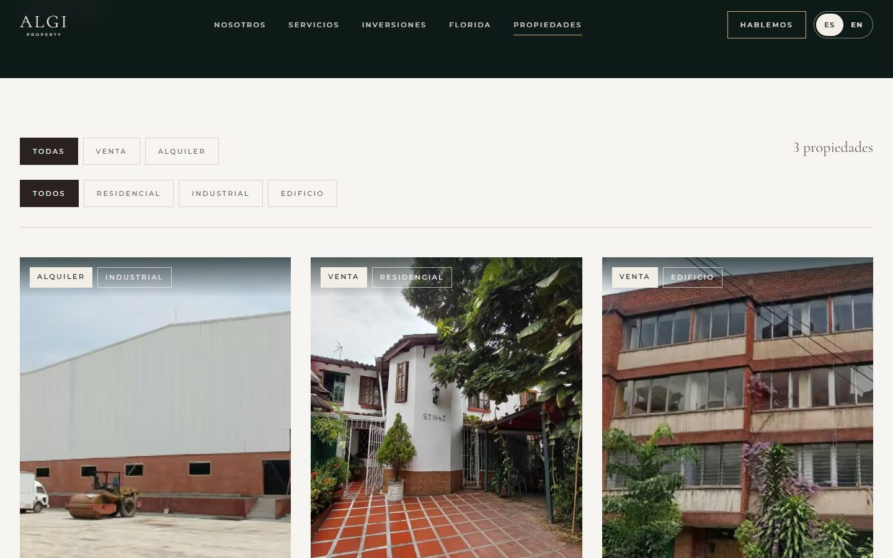
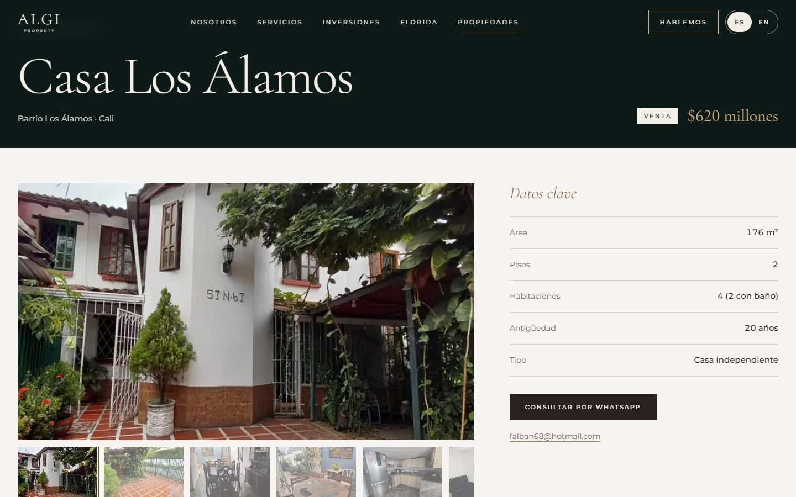
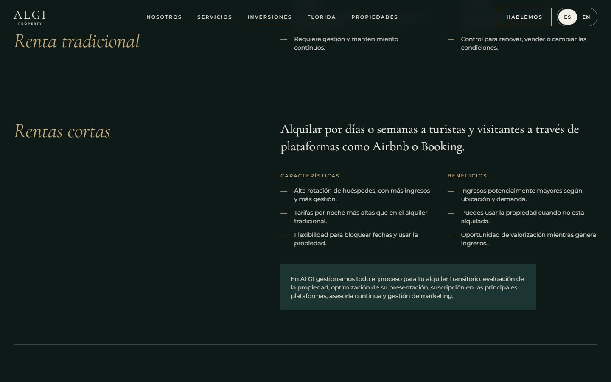
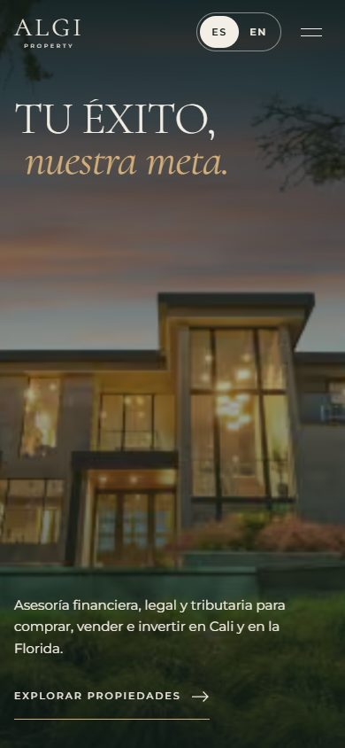

# ALGI Property

Sitio web bilingüe (español e inglés) para **ALGI Property**, una consultoría inmobiliaria de Cali, Colombia, con servicios de asesoría financiera, legal y tributaria, compra y venta, inversión y un puente de inversión hacia la Florida, EE. UU.

**Sitio en vivo: [algi-property.vercel.app](https://algi-property.vercel.app)**

Es un proyecto de portafolio personal. La empresa tuvo un sitio web anterior que ya no existe, y este es un rediseño hecho con el contenido, el logo y los inmuebles que ALGI Property proporcionó para este fin.



## Qué incluye

- **Portada cinematográfica** a pantalla completa, con zoom lento de la foto, parallax al desplazar y titulares que suben desde una máscara.
- **Español e inglés** con un botón ES / EN arriba a la derecha. Un clic cambia el idioma y conserva la página en la que estás. Si entras por `/`, el sitio detecta el idioma del navegador.
- **7 secciones**: Inicio, Nosotros, Servicios, Inversiones, Florida, Propiedades y Contacto.
- **Catálogo de 9 propiedades** (Cali, Yumbo y Bogotá) con filtros por operación (venta o alquiler) y categoría (residencial o comercial). Al elegir comercial se despliega un tercer filtro por tipo: lotes, locales, bodegas, edificios, oficinas y hoteles. Las tarjetas se reordenan con animación y los filtros viven en la URL (`?operacion=venta&categoria=comercial&tipo=local`), así se pueden compartir.
- **Ficha por inmueble** con galería, vista ampliada accesible (teclado, Escape), datos clave y botón de WhatsApp con un mensaje ya redactado para esa propiedad.
- **Formulario de contacto** que valida los campos y abre WhatsApp o el correo con el mensaje listo. No tiene servidor ni guarda datos.
- **SEO**: etiquetas `hreflang`, canónicas, Open Graph, `sitemap.xml`, `robots.txt` y datos estructurados de `RealEstateAgent`.
- **Accesibilidad**: enlace para saltar al contenido, foco visible, navegación completa por teclado, contrastes WCAG AA y respeto de "reducir movimiento".

| Inglés | Inglés |
|---|---|
|  |  |

| Catálogo | Ficha de inmueble |
|---|---|
|  |  |

| Inversiones | Móvil |
|---|---|
|  |  |

## Stack

| Área | Herramientas |
|---|---|
| Framework | Next.js 16 (App Router, Cache Components), React 19, TypeScript |
| Estilos | Tailwind CSS 4 con tokens de diseño propios |
| Idiomas | next-intl (rutas `/es` y `/en`) |
| Movimiento | Motion, Lenis (scroll suave) y animaciones CSS ligadas al scroll |
| Pruebas | Playwright y axe-core |
| Tipografía | Cormorant Garamond y Montserrat, alojadas en el propio sitio con `next/font` |

Los datos de los inmuebles están en archivos locales (`src/data/`) y el contenido de las páginas en `src/content/`, en ambos idiomas. No hay base de datos.

## Cómo correrlo

Requisitos: Node.js 20 o superior.

```bash
npm install
npm run dev          # http://localhost:3000
```

Para probar el build de producción:

```bash
npm run build
npm run start
```

Variable opcional (ver `.env.example`): `NEXT_PUBLIC_SITE_URL`, la URL pública del sitio, usada para canónicas, sitemap y Open Graph.

## Pruebas

La suite de extremo a extremo corre sobre el build de producción y usa el Chrome instalado en el equipo.

```bash
npm run build
npm run test:e2e
```

Son 113 pruebas:

- Cada una de las 16 páginas en ambos idiomas responde 200, tiene un solo `h1`, no se desborda en 390 px y no tiene violaciones serias de accesibilidad (axe, WCAG 2.2 AA).
- Cambio de idioma, detección del idioma del navegador, filtros del catálogo (operación, categoría y tipo comercial), galería, formulario (validación y mensaje de WhatsApp) y menú móvil.
- 404 reales, sitemap y cabeceras de seguridad.

También hay `npm run lint` y `npm run typecheck`.

## Calidad

Lighthouse sobre el build de producción, en móvil con red y CPU limitadas por simulación:

| Rendimiento | Accesibilidad | Buenas prácticas | SEO |
|---|---|---|---|
| 85 a 98 | 100 | 100 | 100 |

En escritorio el rendimiento fue de 98 a 100. `npm audit` no reporta vulnerabilidades.

## Decisiones técnicas

- **Cabeceras de seguridad** en `next.config.ts`: CSP, `X-Frame-Options`, `Referrer-Policy`, `Permissions-Policy` y HSTS. La CSP permite scripts en línea porque Next.js los necesita para hidratar las páginas prerenderizadas; no se carga ningún recurso de terceros.
- **404 reales**: con Cache Components, una ficha inexistente se transmitiría con estado 200. El `proxy` la reescribe hacia una ruta desconocida para que responda 404 con el diseño del sitio.
- **Entrada al hacer scroll solo con CSS** (`animation-timeline: view()`): el contenido está en el HTML inicial y no depende de la hidratación de React, lo que mejoró el LCP.
- **Formulario sin servidor**: arma el mensaje en el navegador y lo abre en WhatsApp o en el cliente de correo. Un siguiente paso natural sería enviarlo con un servicio como Resend.
- **Fotos optimizadas**: las fichas originales pesaban 41 MB en PDF. `scripts/optimizar-fotos.py` extrae y convierte las fotos a WebP (1,9 MB en total).

## Estructura

```
messages/          textos de la interfaz (es.json, en.json)
public/images/     fotos de inmuebles y de ambientación
scripts/           optimización de fotos
src/app/           rutas, layout, sitemap, robots
src/components/    componentes de interfaz
src/content/       contenido de las páginas en ambos idiomas
src/data/          inmuebles, contacto y créditos de fotos
src/i18n/          configuración de idiomas y navegación
tests/e2e/         pruebas de Playwright
DESIGN.md          sistema de diseño: color, tipografía, movimiento
```

## Contenido y créditos

- **Marca, textos e inmuebles**: pertenecen a ALGI Property y se usan con su autorización como proyecto de portafolio. Las imágenes del edificio remodelado en la ficha del Edificio Granada son ilustrativas y están rotuladas como tal.
- **Fotos de ambientación** (licencia de Unsplash): portada, [Michael Brown](https://unsplash.com/@vettexan); Miami, [Pratham Verma](https://unsplash.com/@vpratham04) y [Jairo Gonzalez](https://unsplash.com/@jair0g0nza); Cali, [JUAN MANUEL GONZALEZ RESTREPO](https://unsplash.com/photos/HjUAiKw1m-E) y [Andres F. Uran](https://unsplash.com/@andresuran).
- **Cifras de financiamiento y requisitos** de las páginas Servicios y Florida provienen del contenido original y son informativas, no asesoría financiera.

## In English

Bilingual (Spanish / English) website for ALGI Property, a real estate consultancy in Cali, Colombia. Built with Next.js 16, TypeScript, Tailwind CSS 4 and next-intl, it features a cinematic full-screen hero, a filterable catalogue of 9 properties (residential and commercial), property detail pages with an accessible gallery, a WhatsApp/email contact form and full SEO. It scores 100 for accessibility, best practices and SEO on Lighthouse, and ships with 113 end-to-end tests (Playwright and axe). It is a personal portfolio project built with content supplied by the company.

## Autor

Juan José Alban · [@alban0918](https://github.com/alban0918)
